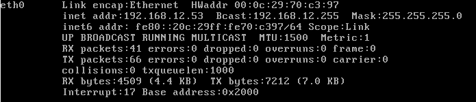

#Gruppe 2
#Networking zwischen Kali und Metasploitable**
#### [Aufgabenstellung](https://www.franzmatejka.at/htl/doc/ITSI_3/itsi3-lab/02_network.html)


## Übung  2.1 (Netzwerk NAT/Bridged)

**Bridge:**
**Kali**
`$ ip a`
```
1: lo: <LOOPBACK,UP,LOWER_UP> mtu 65536 qdisc noqueue state UNKNOWN group default qlen 1000
    link/loopback 00:00:00:00:00:00 brd 00:00:00:00:00:00
    inet 127.0.0.1/8 scope host lo
       valid_lft forever preferred_lft forever
    inet6 ::1/128 scope host noprefixroute 
       valid_lft forever preferred_lft forever
2: eth0: <BROADCAST,MULTICAST,UP,LOWER_UP> mtu 1500 qdisc fq_codel state UP group default qlen 1000
    link/ether 00:0c:29:43:2a:65 brd ff:ff:ff:ff:ff:ff
    inet 192.168.12.52/24 brd 192.168.12.255 scope global dynamic noprefixroute eth0
       valid_lft 172627sec preferred_lft 172627sec
    inet6 fe80::5f67:eae9:75f3:19a3/64 scope link noprefixroute 
       valid_lft forever preferred_lft forever
```

**ping Metasploitable von Kali:** `$ ping 192.168.12.53`


<br>

**Metasploitable:** `$ ifconfig eth0`
 

**ping Kali von Metasploitable:** `$ ping 192.168.12.52`


